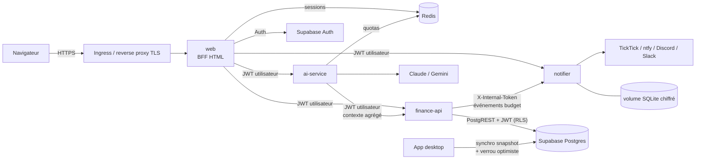

# Architecture Fintrack v2.0

## Principes

| Principe | Mise en œuvre |
|---|---|
| **Un propriétaire par donnée** | Seul finance-api lit/écrit les données financières ; notifier possède ses préférences ; web ne possède que les sessions. |
| **Identité propagée, jamais supposée** | Le JWT Supabase de l'utilisateur est transmis à chaque appel et **vérifié localement par chaque service** (JWKS ES256 : signature, expiration, émetteur, audience). PostgreSQL applique ensuite la RLS : même un service compromis ne voit que les lignes de l'utilisateur dont il porte le jeton. |
| **Moindre privilège** | Aucune clé `service_role`. Appel service → service sans utilisateur (finance-api → notifier) : secret partagé dédié. Clés IA uniquement dans ai-service, secret TickTick uniquement dans notifier. |
| **Sans état quand c'est possible** | web, finance-api, ai-service : réplicables (HPA). notifier (planificateur + SQLite) et Redis : 1 instance. |
| **Défaillance isolée** | web fonctionne sans ai-service / notifier (fonctions masquées) ; une alerte qui échoue n'empêche jamais une saisie. |
| **Données minimales vers l'IA** | ai-service ne reçoit qu'un contexte agrégé (totaux, moyennes, top postes), jamais les opérations une à une ; consentement explicite dans l'interface ; sortie de catégorisation validée contre la liste réelle. |

## Écriture des données : desktop et web

- **Web (finance-api)** : écritures ligne par ligne via PostgREST. Chaque écriture met à jour `app_settings.last_supabase_sync`. Identifiants `max(id)+1` par utilisateur avec reprise sur conflit (le schéma partagé avec l'app desktop impose des id attribués par le client).
- **Desktop** : synchronisation par instantané (tout supprimer puis réinsérer). **Verrou optimiste** ajouté en v2.0 : avant d'envoyer, l'app compare l'horodatage distant au sien ; s'il est plus récent (saisie web ou autre PC), l'envoi est refusé avec un message invitant à récupérer d'abord. Plus aucune perte silencieuse.

## Sécurité de la plateforme

| Couche | Compose | Kubernetes (chart Helm) |
|---|---|---|
| Réseau | `backend` interne sans Internet ; seul web publié (127.0.0.1) | NetworkPolicy deny-all + flux explicites ; sortie 443 uniquement, plages privées et 169.254.0.0/16 exclues |
| Conteneurs | non-root, rootfs RO, `cap_drop: ALL`, `no-new-privileges`, PIDs/CPU/mémoire limités | Pod Security `restricted`, seccomp RuntimeDefault, mêmes durcissements |
| Secrets | fichiers montés `/run/secrets` (`*_FILE`) | Secret existant (Sealed Secrets / ESO) ou généré par le chart (clés internes conservées aux mises à jour) |
| Identité | — | 1 ServiceAccount par service, jeton d'API non monté |
| Disponibilité | healthchecks + `depends_on: service_healthy` | startup/liveness/readiness, HPA, PDB, topologySpread, RollingUpdate sans indisponibilité |
| Chaîne logicielle | images de base épinglées par digest | images et chart signés cosign (GHCR + Docker Hub), provenance SLSA + SBOM attestées |
