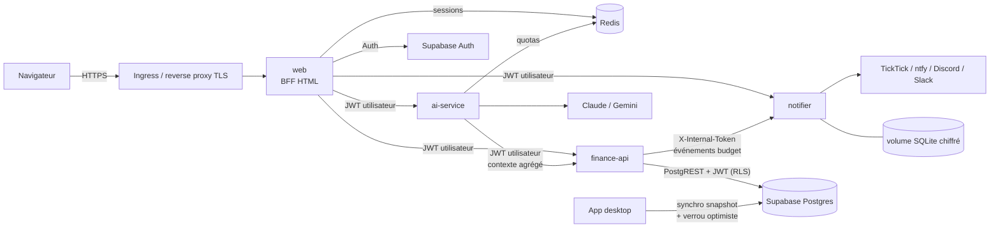

# Architecture Fintrack v2.0

## Principes

| Principe | Mise en œuvre |
|---|---|
| **Un propriétaire par donnée** | Seul finance-api lit/écrit les données financières ; notifier possède ses préférences ; web ne possède que les sessions. |
| **Identité propagée, jamais supposée** | Le JWT Supabase de l'utilisateur est transmis à chaque appel et **vérifié localement par chaque service** (JWKS ES256 : signature, expiration, émetteur, audience). PostgreSQL applique ensuite la RLS : même un service compromis ne voit que les lignes de l'utilisateur dont il porte le jeton. |
| **Moindre privilège** | Aucune clé `service_role`. Appel service → service sans utilisateur (finance-api → notifier) : secret partagé dédié. Clés IA uniquement dans ai-service, secret TickTick uniquement dans notifier. Conséquence assumée : aucun traitement planifié ne lit les données financières (le bilan IA est généré à la demande, les alertes partent lors d'une saisie). |
| **Sans état quand c'est possible** | web, finance-api, ai-service : réplicables (HPA). notifier (planificateur + SQLite) et Redis : 1 instance. |
| **Défaillance isolée** | web fonctionne sans ai-service / notifier (fonctions masquées) ; une alerte qui échoue n'empêche jamais une saisie. |
| **Données minimales vers l'IA** | ai-service ne reçoit qu'un contexte agrégé (totaux mensuels et par catégorie, moyennes calculées sur les seuls mois saisis et complets, top postes), plus les quelques dépenses inhabituelles déjà détectées — jamais la liste des opérations ; consentement explicite dans l'interface ; sortie de catégorisation validée contre la liste réelle. |

## Écriture des données : desktop et web

Depuis la v2.3, toutes les écritures passent par deux fonctions SQL
(`supabase/migration_v2_3_atomic.sql`), en `SECURITY INVOKER` (la RLS de
l'appelant s'applique) et sous un verrou transactionnel par utilisateur
(`pg_advisory_xact_lock`) qui sérialise ses écritures.

- **Web (finance-api)** : chaque opération métier (saisie, saisie groupée, récurrentes, épargne → compte lié du patrimoine, budgets, clôture…) est une liste d'opérations exécutée par `fintrack_apply` en **une transaction** : tout ou rien. Les identifiants sont attribués en SQL (plus de `max(id)+1` côté client ni de réessais), « mois clôturé ? » est vérifié dans la transaction, et la version de synchro `app_settings.last_supabase_sync` avance dans cette même transaction.
- **Desktop** : l'envoi complet passe par `fintrack_replace_snapshot`, qui supprime et réinsère toutes les tables de l'utilisateur en **une transaction**. Une panne au milieu ne laisse plus Supabase à moitié vide.
- **Verrou optimiste par version** : `last_supabase_sync` est un jeton opaque attribué par le serveur et comparé par **égalité**. Le PC envoie la version qu'il connaît (dernier envoi ou dernière récupération) ; si elle a changé (saisie web, autre PC), le serveur refuse l'envoi, sous verrou, sans fenêtre entre contrôle et écriture. Les horloges du PC et du serveur ne sont jamais comparées : un PC dont l'horloge avance ne peut plus écraser une saisie web.

## Sécurité de la plateforme

| Couche | Compose | Kubernetes (chart Helm) |
|---|---|---|
| Réseau | `backend` interne sans Internet ; seul web publié (127.0.0.1) | NetworkPolicy deny-all + flux explicites ; sortie 443 uniquement, plages privées et 169.254.0.0/16 exclues |
| Conteneurs | non-root, rootfs RO, `cap_drop: ALL`, `no-new-privileges`, PIDs/CPU/mémoire limités | Pod Security `restricted`, seccomp RuntimeDefault, mêmes durcissements |
| Secrets | fichiers montés `/run/secrets` (`*_FILE`) | Secret existant (Sealed Secrets / ESO) ou généré par le chart (clés internes conservées aux mises à jour) |
| Identité | — | 1 ServiceAccount par service, jeton d'API non monté |
| Disponibilité | healthchecks + `depends_on: service_healthy` | startup/liveness/readiness, HPA, PDB, topologySpread, RollingUpdate sans indisponibilité |
| Chaîne logicielle | images de base épinglées par digest | images et chart signés cosign (GHCR + Docker Hub), provenance SLSA + SBOM attestées |
