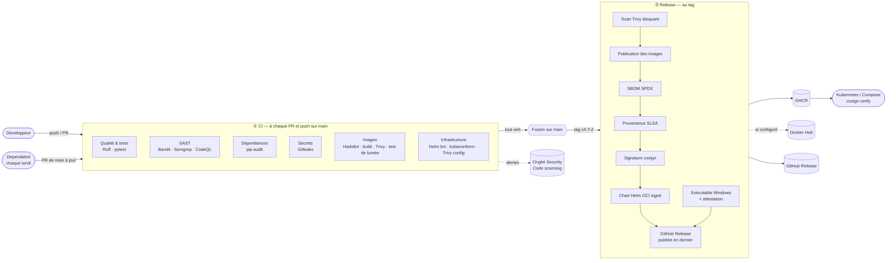
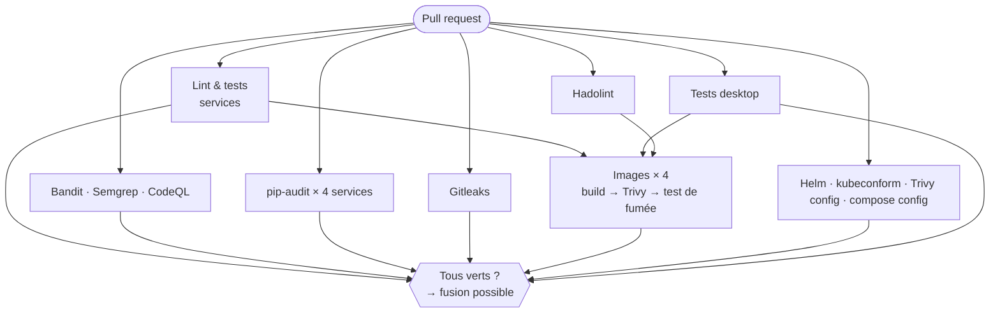
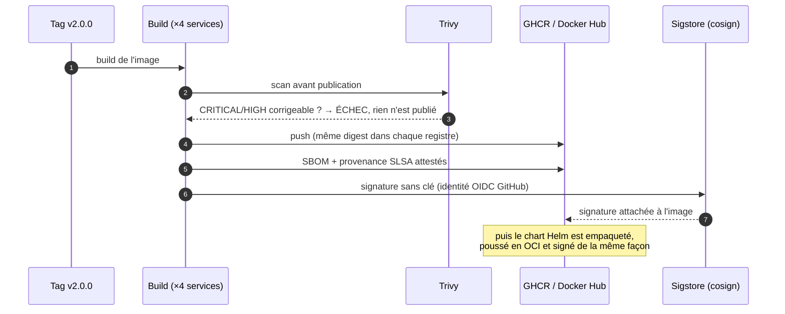
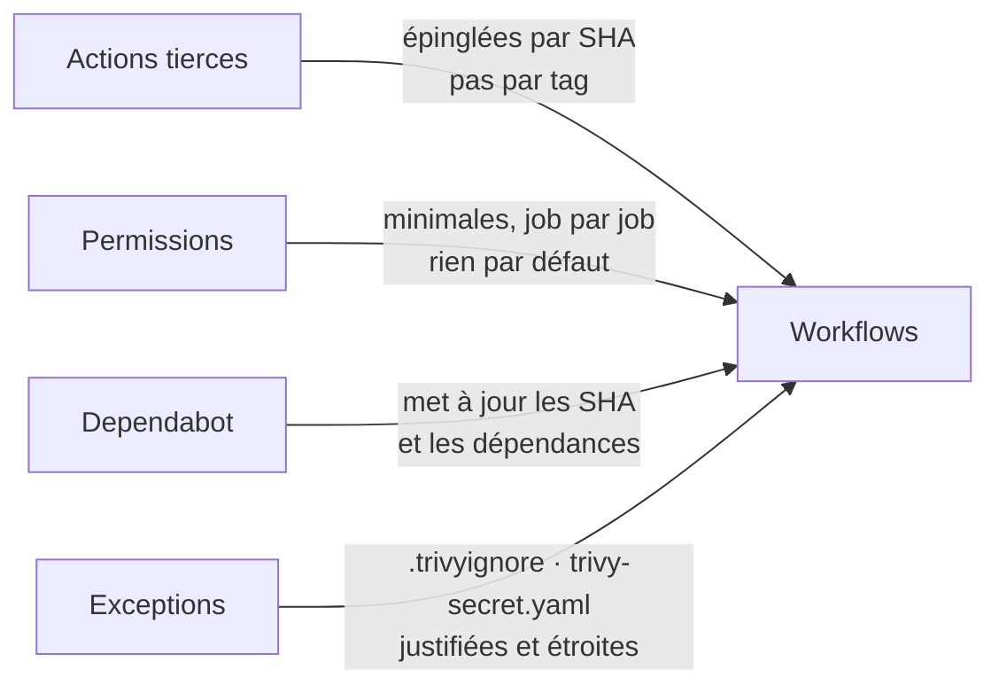

# DevSecOps — la chaîne de sécurité de Fintrack

La sécurité est contrôlée **à chaque étape**, du commit jusqu'à l'image déployée, et pas seulement à la fin. Tout est automatisé dans GitHub Actions : un problème bloque la fusion ou la publication avant d'atteindre la production.

## Vue d'ensemble



## ① CI — chaque PR et chaque push sur `main`



| Étape | Outil | Ce qu'elle détecte | Bloquant |
|---|---|---|---|
| Qualité | **Ruff** (avec les règles de sécurité `S`) | erreurs, motifs de code dangereux | oui |
| Tests | **pytest** | régressions, y compris les failles déjà corrigées (CSRF, open redirect, SSRF, écrasement de données) | oui |
| SAST | **Bandit**, **Semgrep** (Python, OWASP Top 10, secrets, Dockerfile, Kubernetes), **CodeQL** (`security-extended`) | injections, redirections ouvertes, crypto faible, validations incomplètes | oui |
| SCA | **pip-audit** (une analyse par service) | bibliothèques ayant une CVE publiée | oui |
| Secrets | **Gitleaks** (tout l'historique git) | mot de passe ou clé commité par erreur | oui |
| Dockerfile | **Hadolint** | mauvaises pratiques de construction d'image | oui |
| Images | **Trivy** + test de fumée | CVE des paquets système et Python, secrets dans l'image ; démarrage en non-root, système de fichiers en lecture seule | oui (CRITICAL/HIGH corrigeables) |
| Infrastructure | **helm lint --strict**, **kubeconform**, **Trivy config**, `docker compose config` | manifestes invalides, conteneurs root, droits excessifs, absence de limites | oui (CRITICAL/HIGH) |
| Desktop | build **PyInstaller** (PR vers `main`) | l'exécutable Windows se construit | oui |

> CodeQL tourne aussi **chaque lundi**, sur le code inchangé, pour profiter des nouvelles règles de détection.

## ② Release — au tag `vX.Y.Z`



| Étape | Rôle |
|---|---|
| **Scan Trivy bloquant** | aucune image vulnérable n'est jamais publiée |
| **Publication** | GHCR, toujours ; Docker Hub si `DOCKERHUB_USERNAME` et `DOCKERHUB_TOKEN` sont configurés |
| **SBOM (SPDX)** | inventaire complet de ce que contient l'image |
| **Provenance SLSA** | preuve de *comment* et *où* l'image a été construite |
| **Signature cosign (sans clé)** | signée avec l'identité du workflow GitHub, sans clé à gérer ni à protéger |
| **Chart Helm** | publié en OCI et signé, version alignée sur le tag |
| **Exécutable Windows** | archive ZIP attestée, conservée en attendant la fin du pipeline |
| **GitHub Release** | créée **en dernier**, seulement si l'exécutable, les 4 images et le chart sont publiés : jamais de release partielle |
| **Nettoyage en cas d'échec** | le tag est supprimé automatiquement ; on corrige puis on retague |

## ③ Le pipeline est lui-même protégé



- **Actions épinglées par SHA** : si le tag d'une action tierce est compromis, il ne peut rien injecter.
- **Permissions minimales** : chaque job ne reçoit que les droits dont il a besoin, par exemple `packages: write` uniquement pour publier.
- **Exceptions documentées** : seuls des faux positifs justifiés, au périmètre le plus étroit possible.
- **Runtime à jour** : toutes les actions JavaScript tournent sur **Node.js 24** (Node 20 est déprécié par GitHub). Dependabot propose chaque semaine les nouvelles versions.

## Sécurité intégrée à l'application et à la plateforme

| Couche | Mesures |
|---|---|
| Application web | sessions côté serveur chiffrées, CSRF, CSP stricte, limitation des tentatives par (IP, compte), redirections locales uniquement, anti-SSRF pour les notifications |
| Identité | JWT Supabase vérifiés par **chaque** service (JWKS, ES256), RLS PostgreSQL, aucune clé `service_role` |
| Conteneurs | non-root (UID 10001), système de fichiers en lecture seule, aucune capacité Linux, pas de pip dans l'image, base épinglée par digest, correctifs Debian appliqués au build |
| Kubernetes | NetworkPolicies « tout interdit » puis flux explicites, sortie Internet limitée au 443 sans plages privées, Pod Security `restricted`, ServiceAccounts sans jeton |

## Exploiter les résultats

| Où | Quoi |
|---|---|
| **PR → onglet Checks** | statut de chaque job (rouge ou vert) |
| **Security → Code scanning** | toutes les alertes CodeQL, Trivy, Bandit et Semgrep au même endroit |
| **Pull requests Dependabot** | à relire puis fusionner si la CI est verte (attention aux versions majeures) |
| **Actions → Release → résumé** | digests des images et du chart publiés |

### Vérifier une image ou le chart publiés

```bash
# Image
cosign verify ghcr.io/moussaoudihat/fintrack-web:2.0.0 \
  --certificate-identity-regexp 'https://github.com/MoussaOudihat/finance-tracker/.*' \
  --certificate-oidc-issuer https://token.actions.githubusercontent.com

# Provenance et SBOM attestés
gh attestation verify oci://ghcr.io/moussaoudihat/fintrack-web:2.0.0 --owner MoussaOudihat

# Chart Helm
cosign verify ghcr.io/moussaoudihat/charts/fintrack:2.0.0 \
  --certificate-identity-regexp 'https://github.com/MoussaOudihat/finance-tracker/.*' \
  --certificate-oidc-issuer https://token.actions.githubusercontent.com
```

## Ce que la chaîne a déjà intercepté

| Problème | Détecté par | Étape |
|---|---|---|
| Redirection ouverte via l'en-tête Referer | CodeQL | CI |
| Contrôle d'hôte Slack contournable (`evilslack.com`) | CodeQL | CI |
| `setuptools` vulnérable embarqué dans pip | Trivy (images) | CI |
| CVE `apt` publiée le matin même | Trivy (gate bloquant) | CI |
| Directive Compose refusée par Docker | `docker compose config` | CI |
| Faux positif « clé GCP » dans le SDK Anthropic | Trivy (secrets) | CI — exception ciblée |
| Nom d'image vide quand Docker Hub n'est pas configuré | 1re release | Release — corrigé, release jamais publiée partiellement |

---
Fichiers concernés : `.github/workflows/ci.yml`, `release.yml`, `codeql.yml`, `.github/dependabot.yml`, `.trivyignore`, `trivy-secret.yaml`, `SECURITY.md`.
