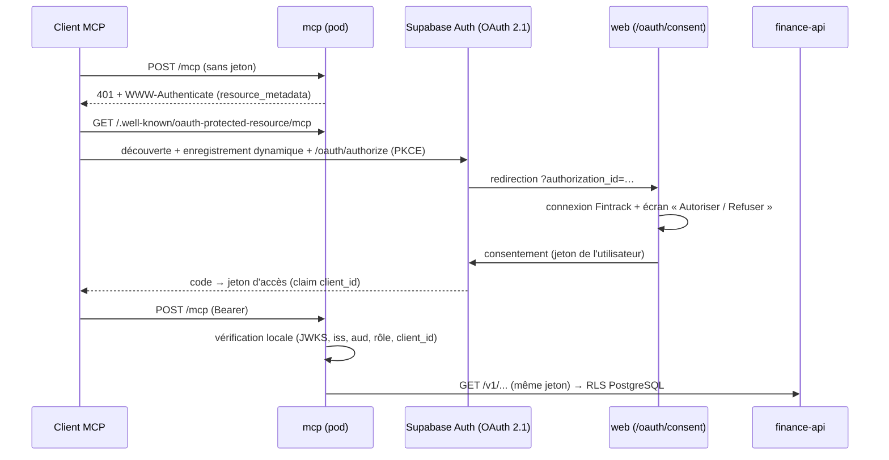

# Serveur MCP Fintrack (lecture seule)

Interroger ses données Fintrack depuis un client MCP — **Claude Code**,
**claude.ai / Claude Desktop** (connecteur personnalisé), **opencode** — en
langage naturel : « combien ai-je dépensé en restaurants depuis juin ? »,
« compare mon taux d'épargne à l'an dernier », « liste mes abonnements »…



## Garanties de sécurité

| Garantie | Mise en œuvre |
|---|---|
| Lecture seule | Le serveur n'expose que des outils de lecture (`readOnlyHint`) qui n'appellent que des `GET`. **Et** la base refuse toute écriture à un jeton OAuth (politiques RLS `RESTRICTIVE`, `supabase/migration_mcp_readonly.sql`), même si le pod était compromis. |
| Isolation par utilisateur | Le jeton de l'utilisateur est retransmis à finance-api puis PostgREST : la RLS ne laisse voir que ses lignes. Aucune clé `service_role`. |
| Pas de jeton de session détourné | Un jeton sans `client_id` (session web/desktop) est refusé (`MCP_REQUIRE_OAUTH_CLIENT=true`). |
| Consentement explicite | Écran web « Autoriser / Refuser » ; protégé par CSRF ; demande revérifiée côté serveur. |
| Anti-phishing OAuth | L'enregistrement dynamique laisse n'importe qui déclarer un client : seules les adresses de retour en boucle locale (`http://localhost`, clients CLI) et les hôtes https de `OAUTH_ALLOWED_REDIRECT_HOSTS` (défaut `claude.ai,claude.com`) peuvent être approuvées. |
| Anti DNS-rebinding | En-tête `Host` limité à l'hôte public ; `Origin` d'un autre site refusé. |
| Réseau | NetworkPolicy : entrée depuis l'Ingress uniquement, sortie vers finance-api (et HTTPS pour les clés JWKS). |
| Données minimales (option) | `mcp.exposeDetails: false` : seuls les agrégats sont exposés (pas de liste d'opérations ni de recherche). |

⚠️ Les données consultées sont envoyées au modèle d'IA du client (Anthropic
pour Claude). C'est un choix différent de l'assistant IA intégré, qui ne
transmet que des agrégats : activez le MCP en connaissance de cause.

## Outils

| Outil | Contenu |
|---|---|
| `get_financial_context` | Résumé agrégé des N derniers mois saisis (point de départ recommandé) |
| `get_month_summary` | Bilan d'un mois : totaux, catégories, budgets |
| `get_history` | Totaux mensuels sur N mois |
| `get_analytics` | Tendances par catégorie, dépenses inhabituelles |
| `get_net_worth` | Patrimoine : actifs, passifs, net |
| `get_savings_overview` | Épargne : taux, comptes, objectifs |
| `get_recurring` | Transactions récurrentes et statut du mois |
| `list_categories` | Catégories de dépenses |
| `get_month_entries` * | Opérations détaillées d'un mois |
| `search_entries` * | Recherche dans tout l'historique |
| `list_payees` * | Enseignes les plus fréquentes |

\* masqués si `mcp.exposeDetails: false`. Sans année/mois, les outils prennent
le dernier mois contenant des saisies.

## Mise en place

### 1. Supabase

1. **SQL Editor** : exécuter, dans l'ordre, `supabase/migration_v2_3_atomic.sql` puis `supabase/migration_mcp_readonly.sql` (idempotents).
2. **Authentication → URL Configuration** : *Site URL* = `https://<votre-hôte>`.
3. **Authentication → OAuth Server** : activer le serveur OAuth 2.1,
   *Authorization path* = `/oauth/consent`, activer l'**enregistrement
   dynamique des clients** (nécessaire pour Claude / opencode).

### 2. Kubernetes

```yaml
# values-production.yaml
mcp:
  enabled: true
  # publicUrl: https://fintrack.example.com/mcp   # défaut : https://<ingress.host>/mcp
  # exposeDetails: false                          # agrégats uniquement
  # allowedRedirectHosts: claude.ai,claude.com
```

```bash
helm upgrade --install fintrack <chart> -n fintrack -f values-production.yaml
curl https://fintrack.example.com/.well-known/oauth-protected-resource/mcp
```

L'Ingress route `/mcp` et `/.well-known/oauth-protected-resource*` vers le
pod `mcp`, le reste vers `web`. Image : `fintrack-mcp` (même Dockerfile,
`SERVICE=mcp_server`).

### 3. Clients

**Claude Code**

```bash
claude mcp add --transport http fintrack https://fintrack.example.com/mcp
# puis /mcp dans Claude Code → « Authenticate » : le navigateur ouvre l'écran de consentement
```

**opencode** (`opencode.json`)

```json
{
  "mcp": {
    "fintrack": { "type": "remote", "url": "https://fintrack.example.com/mcp" }
  }
}
```

puis `opencode mcp auth fintrack`.

**claude.ai / Claude Desktop** : Paramètres → Connecteurs → *Ajouter un
connecteur personnalisé* → `https://fintrack.example.com/mcp`.

### Révoquer un accès

Supabase Dashboard → Authentication → OAuth Apps (clients enregistrés), ou
déconnexion du serveur dans le client. Les jetons d'accès expirent après
1 heure (durée Supabase par défaut).

## Configuration (variables d'environnement)

| Variable | Service | Défaut | Rôle |
|---|---|---|---|
| `MCP_PUBLIC_URL` | mcp | — (obligatoire) | URL publique `https://<hôte>/mcp` (identifiant de ressource) |
| `MCP_EXPOSE_DETAILS` | mcp | `true` | Exposer les opérations détaillées |
| `MCP_REQUIRE_OAUTH_CLIENT` | mcp | `true` | Refuser les jetons sans `client_id` |
| `MCP_EXTRA_ALLOWED_HOSTS` | mcp | — | En-têtes `Host` supplémentaires (tests, port-forward) |
| `FINANCE_API_URL` | mcp | — | URL interne de finance-api |
| `OAUTH_ALLOWED_REDIRECT_HOSTS` | web | `claude.ai,claude.com` | Hôtes https de retour OAuth autorisés |

## Développement

```bash
cd services
FINTRACK_NO_AUTOAPP= SUPABASE_URL=https://<projet>.supabase.co \
MCP_PUBLIC_URL=http://localhost:8010/mcp FINANCE_API_URL=http://localhost:8001 \
PYTHONPATH=.:common uvicorn mcp_server.app.main:app --port 8010
```

Tests : `services/tests/test_mcp.py` (serveur) et
`services/tests/test_oauth_consent.py` (page de consentement).
